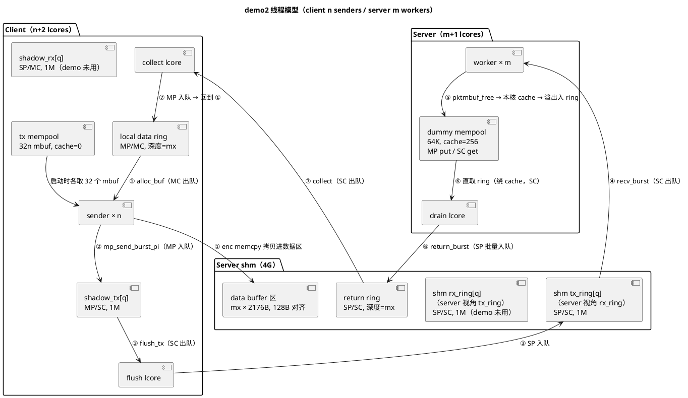
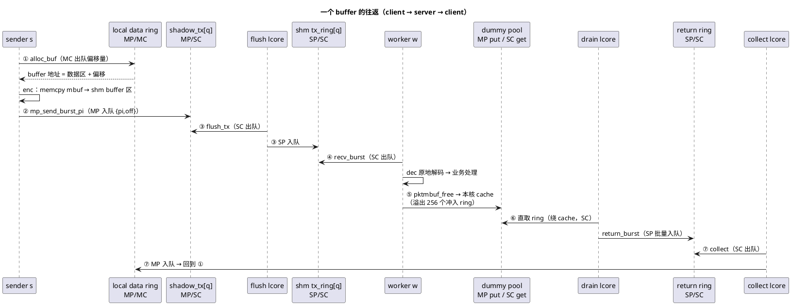

# ub_ring 通信模型（demo2）

> 适用版本：当前代码仓（DPDK 24.11 + ABI 25.0）
> 涉及代码：`lib/ub_ring/`（L2 缓冲传输）、`drivers/net/ub_ring/`（ethdev PMD）、`demo2/`（client/server 应用）

约定：client 有 **n 个 sender 线程**、server 有 **m 个 worker 线程**（server 队列数 nq = m）。
单 provider 场景下总队列数 tq = m；多 provider 时 tq = 各 provider 的 nq 之和，队列号按 provider 顺序拼接。

## 1. ring / mempool 资源清单

### 1.1 server 共享内存内（4G，provider 创建）

shm 布局：`metadata → 2×nq 个 1M 深收发环 → return 环 → 数据缓冲区（128B 对齐）`。

| 资源 | 创建者 | 规格 | flags | 生产者（线程） | 消费者（线程） |
|---|---|---|---|---|---|
| shm 环 `rx_q{q}` `tx_q{q}` | provider_init | 1M 深，每队列 2 个，共 2×tq | SP_ENQ \| SC_DEQ | 见 1.2 说明 | 见 1.2 说明 |
| return 环 `ret_{shm}` | **user_init**（写入 server shm） | **mx** 深，每 provider 1 个 | SP_ENQ \| SC_DEQ（**SPSC**） | server drain 线程 | client collect 线程 |
| data buffer 区 | **user_init**（布局） | **mx** 个元素 × elt=2176B | —（裸缓冲区，非环） | — | — |

- `elt = RTE_ALIGN(128, sizeof(rte_mbuf) + RTE_MBUF_DEFAULT_BUF_SIZE)` = 2176B，每个 buffer 128B 对齐
- `mx = align32prevpow2((shm 剩余空间 - ring 结构 - 128) / (8 + elt))`，4G/nq=4 时约 **1M**；本地 data ring 深度 = return 环深度 = 数据区元素数 = mx
- 同一物理 shm 环双方视角相反：前半区 client 叫 **tx_ring**（server 叫 rx_ring，demo 流量方向）；后半区 client 叫 rx_ring（server 叫 tx_ring，**demo 未用**）

### 1.2 client 本地

| 资源 | 创建者 | 规格 | flags | 生产者（线程） | 消费者（线程） |
|---|---|---|---|---|---|
| 本地 data ring `data_{shm}` | user_init | **mx** 深，每 provider 1 个，元素=偏移量 | 0（**MP/MC**） | collect 线程 + sender 失败回退 free_buf（多个，MP） | n 个 sender 的 alloc_buf（多个，MC） |
| shadow_tx `stx{q}` | enable_mpmc | 1M 深，每队列 | SC_DEQ（**MP/SC**） | n 个 sender（MP） | flush 线程（SC） |
| shadow_rx `srx{q}` | enable_mpmc | 1M 深，每队列 | SP_ENQ（**SP/MC**） | flush 线程（SP） | rx 线程（MC，**demo 未用**） |
| tx mempool `tx` | client main | 32×n 个 mbuf，**cache=0** | MP/MC ring backend | —（不回收） | n 个 sender 启动时各取 32 个，持有全程 |

### 1.3 server 本地

| 资源 | 创建者 | 规格 | flags | 生产者（线程） | 消费者（线程） |
|---|---|---|---|---|---|
| dummy mempool `ub_eth_dummy` | PMD probe | 64K 对象，elt_size=0，**cache=256** | **MP put / SC get**（MEMPOOL_F_SC_GET） | m 个 worker 的 cache 溢出（多个，MP） | drain 线程（唯一，SC） |

> client 侧 PMD probe 也会创建 dummy pool，但 demo 中 client 不接收，永远为空。

## 2. 线程模型

### 2.1 client（n senders，需要 n+2 个 lcore）

| lcore | 线程 | 与 ring / mempool 的交互 |
|---|---|---|
| lc[0] | flush_worker | 循环 tq 个队列：shadow_tx[q] SC 出队 → shm tx_ring[q] SP 入队。**demo 无收包，热路径不做 rx flush**（仅退出时一次性 flush_rx） |
| lc[1] | collect_worker | 循环：return 环 SC 出队 → 本地 data ring MP 入队 |
| lc[2+s] | sender s | 启动：tx pool 取 32 个 mbuf；循环：data ring MC 出队（alloc_buf）→ enc 拷贝进 shm → shadow_tx[q] MP 入队；enc 失败：free_buf MP 入回 data ring |

队列分配：ns ≤ tq 时连续均分（前 rem 个 sender 多拿一个队列，块内 RR）；ns > tq 时 sender s 共享队列 s % tq。

### 2.2 server（m workers，需要 m+1 个 lcore）

| lcore | 线程 | 与 ring / mempool 的交互 |
|---|---|---|
| lc[0] | drain_worker | 循环 `rte_eth_ub_ring_drain(pid)`：dummy ring SC 直取（**绕 cache**）→ return 环 SP 批量入队（return_burst） |
| lc[1+w] | worker w | 循环 rx_burst(q=w)：shm rx_ring[w] SC 出队 → dec 原地解码 → 业务处理 → pktmbuf_free 入本核 cache（溢出 256 个冲入 ring） |

## 3. 一个 buffer 的完整往返（7 站）

每站所有权转移：

| 站 | 位置 | 持有者 |
|---|---|---|
| ① | 本地 data ring | client（空闲） |
| ② | shadow_tx | client sender → flush |
| ③ | shm tx_ring | 在途，等待 server 收 |
| ④ | server worker | 处理中 |
| ⑤ | dummy pool（worker cache → ring） | 已释放，等待归还 |
| ⑥ | return ring | 归还途中 |
| ⑦ | 回到本地 data ring | client（空闲） |

## 4. 并发契约总表

| 环 | flags | 入队方（线程） | 出队方（线程） | 免锁依据 |
|---|---|---|---|---|
| shm tx_ring[q] | SP/SC | client flush（唯一） | server worker w（每队列唯一） | 两端均单线程 |
| shm rx_ring[q] | SP/SC | server 发端（demo 无） | client flush → shadow_rx | 同上 |
| return 环 | **SP/SC** | server drain（唯一；eth_close 的收尾 drain 在所有线程 join 后的主核执行，仍串行） | client collect（唯一） | 两端均单线程 |
| 本地 data ring | MP/MC | collect 线程 + sender 失败回退（多个） | n senders（多个） | 必须 CAS，两侧都多线程 |
| shadow_tx[q] | MP/SC | n senders（多个） | flush 线程（唯一） | 入队 CAS，出队免锁 |
| shadow_rx[q] | **SP/MC** | flush 线程（唯一） | rx 线程（多个，demo 无） | 入队免锁，出队 CAS |
| dummy mempool ring | **MP put / SC get** | m workers 的 cache 溢出（多个） | drain 线程（唯一） | 入队 CAS，出队免锁 |
| tx mempool ring | MP/MC | —（demo 不回收） | n senders 启动分配（多个） | CAS |

## 5. 注意事项

1. **dummy pool 容量**：64K 远小于在途上限 mx≈1M。正常运行 drain 跟得上没问题；若 drain 线程长期停摆，pool 溢出后 `pktmbuf_free` 静默失败，这些 buffer 永久泄漏在 server 端，client 的 data ring 会逐渐耗尽。
2. **收尾残留**：退出瞬间每个 worker 核的 cache 最多压着 ~384 个 mbuf 到不了 ring，这批 buffer 不归还；dummy ring 里不足一批（32）的尾数同理留在 ring 里。只影响收尾统计，不影响运行期。
3. **return 环 SPSC 契约**：入队必须全部来自 drain lcore；`free_buf` 的 provider 分支同样 SP 入队，若 server 侧 TX 失败回退与 drain 并发会破坏契约——demo 中 server 从不 TX。
4. **shadow_rx SPMC**：flush 线程是唯一生产端；demo 无收包流量，flush 线程热路径已去掉 rx flush，仅退出时执行一次 flush_rx。
5. **dummy pool 的 cache 只缓冲 free 方向**：drain 线程出队绕开自己核的 cache 直取 ring——否则 get_bulk 回填会把最多 256 个对象残留在 drain 核的 cache 里永远不归还。
